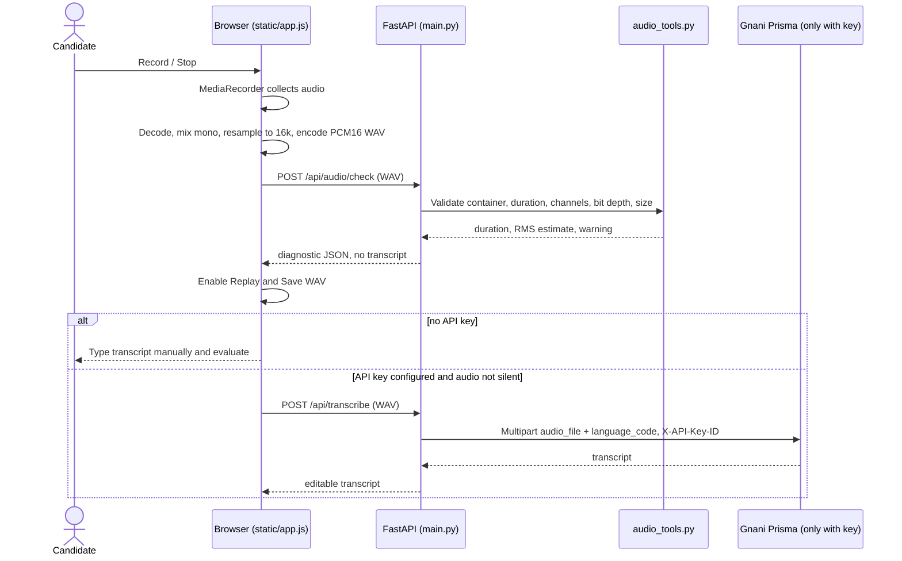

# Local Voice Preflight — Implementation and Technical Rationale

## Problem this fixes

The previous unified UI disabled **Record answer** whenever `GNANI_API_KEY` was missing. That prevented us from determining whether the browser microphone, recorder, decoder, WAV conversion, and FastAPI upload path were working independently of Gnani's website or key provisioning.

The new behavior separates **local audio capture validation** from **paid speech transcription**.

## System sequence

## Where the code changed

| File | Implementation | Reason |
|---|---|---|
| `audio_tools.py` | Validates 16-kHz 16-bit mono PCM WAV (0.2–30s, <=4MB); estimates RMS and peak without ML | Format and near-silence checks are deterministic and cheap |
| `main.py` | `POST /api/audio/check` + shared `_verified_wav_upload()` used by the Prisma route | Avoid diverging validation rules; invalid media rejected before paid calls |
| `static/app.js` | Record allowed in no-key mode; first run a local check; only invoke Prisma when configured; retain WAV for replay/save | Isolate browser problems from provider problems |
| `static/index.html`, `styles.css` | Replay, save, and accessible diagnostic status | Clear feedback when recording stops without transcript |
| `tests/test_audio_preflight.py` | Positive, invalid, silence, and markup checks | Regression coverage without spending Gnani credits |
| `QUICKSTART_WINDOWS.ps1` | Changes directory to the script's own location | Prevents path mistakes during Windows setup |

## Why not automatically transcribe with the browser?

Browser-native speech recognition differs significantly across browsers and can send data to other providers. A silent fallback to browser transcription would undermine the claim that the app uses Gnani Prisma. Therefore, in demo mode we **never display a transcript as though Gnani generated it**. We show a local audio diagnostic and require manual text entry. Real Prisma transcription only occurs when the server has a configured key and the candidate explicitly records in that mode.

## Failure behavior

- Microphone blocked: show the browser permission error; typed answers remain available.
- Empty chunks / unsupported decoding: show a message; don't send to the provider.
- Invalid WAV container, format, or oversized recording: backend returns 4xx; no provider call.
- Very low level (strongly conservative near-silence threshold): warn and prevent a potentially wasted STT request; user can replay and retry.
- Key configured but API call fails: preserve the recorded WAV for replay/save and permit typed submission. **Never claim a successful Gnani transcript.**
- No-key mode: save/replay local WAV, manually type the transcript.

**Privacy:** No raw audio is persisted on the FastAPI server. The local preflight reads audio for validation and discards it; the browser retains a temporary WAV blob until navigating away or proceeding to the next question. In live mode the audio is deliberately sent to Gnani as required for STT, so users should understand that third-party processing is involved.

## Verification evidence

- `python -m pytest -q` — **35 passed** with mocked provider requests.
- `node --check static/app.js` — syntax valid.
- Simulated browser interaction — start, stop, local diagnostic, save-enabled, typed feedback, and no `/api/transcribe` call without a key; no JavaScript errors.
- Real Windows microphone in Chrome/Edge — **not yet tested**.
- Real Gnani English/Telugu endpoints — **not yet tested**.
