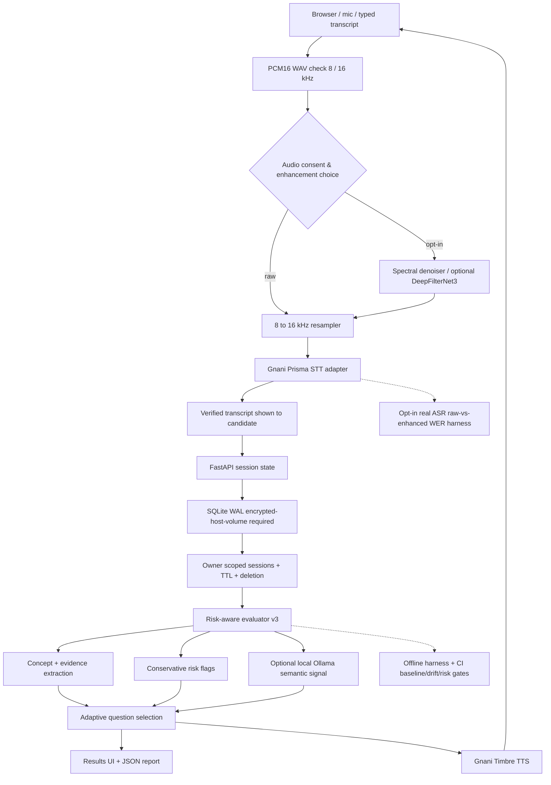

# Implemented architecture — InterviewMirror AI (Nov 9, 2026)

### Trust boundaries

- Browser captures audio and asks for consent before a server-to-Gnani transfer. Never place `GNANI_API_KEY` in browser code or public repositories.
- FastAPI validates content type, binary WAV framing, duration, size and sample rate before provider use.
- Only explicitly consented audio reaches the external provider. Local mic checks never use credits.
- `IM_SEMANTIC_JUDGE=ollama` is opt-in. A quote must be an **exact substring of the submitted answer** to count as grounded; model warnings are not expert verification.
- Sessions persist in SQLite. With `IM_AUTH_REQUIRED=true`, Argon2/JWT authentication and SQL owner filters protect transcripts from cross-account reads. Local demo mode still permits anonymous sessions and MUST NOT be publicly exposed. Postgres, external rate limits, encrypted volumes and external security review remain unverified.

### Test boundaries

- Unit, API, fake-provider integration and synthetic signal-level noise checks execute offline.
- Real provider availability, Telugu WER, noisy call robustness, user acceptance, load testing and security penetration tests require separate verification.
