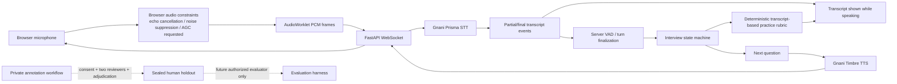

# Current architecture — InterviewMirror ClearView realtime

**Reviewed 15 November 2026 against this archive.** This diagram describes the active ClearView route and separates implemented behavior from optional or unverified capabilities.

## What is implemented

- The integrated ClearView browser route streams audio over a WebSocket and renders transcript updates as they arrive. Backend speech providers are Gnani Prisma STT and Gnani Timbre TTS when a valid key and provider access are configured.
- The browser requests echo cancellation, noise suppression, automatic gain control, and mono capture as **ideal** constraints. This avoids refusing capture if a browser cannot honor an optional constraint. The UI reports the actual track settings when the browser exposes them. Those settings are local diagnostics and are not sent to the backend.
- Turn detection and question progression are implemented in the server state machine. The numeric feedback is deterministic practice logic; it is not a semantic evaluator, expert grade, hiring score, or Gnani Evon output.
- A local gold-data workflow supports consent and PII checks, grouped splitting, blinded independent reviewer forms, disagreement adjudication, holdout sealing, and export of a sealed reviewed holdout to the A/B/C manifest schema. The bundled template has **zero** cases, so there are no human-gold model metrics yet.
- Docker Compose runs the backend and ClearView development frontend together for local review. This is a development arrangement, not a hardened public production deployment.

## Boundaries and unverified behavior

- Browser noise processing is device/browser-controlled. A reported `noiseSuppression: true` only means the track setting is enabled; it does not prove actual noise removal or better Prisma recognition.
- Server spectral filtering is available in an opt-in real-time **second-pass comparison**. The raw Prisma stream remains authoritative; after each answer, the option sends one additional filtered copy to Gnani and displays both transcripts and timings. It is off by default, adds provider use/latency, buffers no more than 30 seconds in memory, and does not persist audio. Without a human reference, transcript disagreement is not accuracy. Four synthetic signal fixtures showed average changes of +3.163 dB SNR and +2.477 dB SI-SDR; these are not ASR accuracy or Telugu-call results. A three-call synthetic Prisma smoke had no valid paired WER and poor outputs; see [live smoke results](LIVE_API_SMOKE_2026-11-15.md). DeepFilterNet3 and representative natural-speech raw-versus-enhanced Prisma WER remain unmeasured.
- The configured key in the earlier user-provided local file has STT/TTS scope only. This archive does not prove its current availability or contain a secret. Evon semantic evaluation and Gnani translation are unavailable without separate documented service access; no substitute model is used here.
- Do not claim a 400–600 ms full-turn response: pause detection, provider calls, and TTS add time. Measure end-to-end p50/p95 on target devices and network before setting a latency target.
- No microphone, speaker, provider, load, or public deployment verification is implied by offline unit tests.

## Local development

Use `docker compose up --build` from the project root, then open `http://127.0.0.1:8082`. To use real speech, provide `GNANI_API_KEY` in a local ignored `.env` file; never put it in frontend variables or source control. The Compose stack is for local development only. See [deployment and security](DEPLOYMENT_AND_SECURITY.md), [dataset workflow](DATASET_AND_EVALUATION_AUDIT.md), and [noise evaluation](NOISE_SEPARATE_EVALUATION.md).
