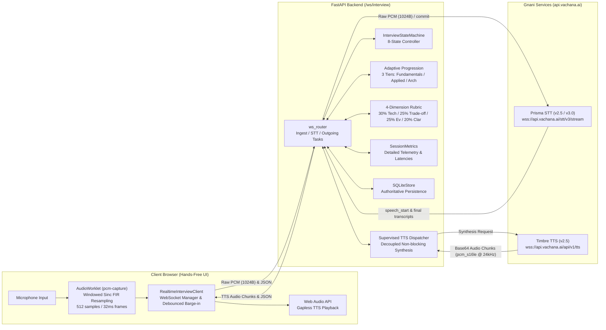

# Realtime Voice Pipeline Architecture (Plan X+ Advancement)

## 1. Overview and High-Level Architecture

InterviewMirror's realtime voice pipeline provides a full-duplex, hands-free conversational technical interview coaching experience powered strictly by Gnani AI's Indic voice models (Prisma STT and Timbre TTS). The candidate chooses a track (`agentic`, `ai`, `software`) and language (`en-IN`, `te-IN`, `hi-IN`), grants microphone consent, and presses **Start interview** once.

From that moment until interview completion, the system automatically speaks questions, listens, detects conversational pauses, processes answers, and advances questions without any manual UI interaction.

---

## 2. Audio Resampling & Acoustic Echo Suppression (Phase 4)

1. **AudioWorklet Resampling (`static/audio-worklet.js`)**:
   - Registered under `'pcm-capture'` in `AudioWorkletGlobalScope`.
   - Captures microphone input from channel 0.
   - Resamples audio dynamically from native device hardware rates (e.g. 44.1 kHz, 48 kHz, 96 kHz) to 16,000 Hz using a **multi-tap windowed sinc FIR filter** (17 taps, Hann window, 7.2 kHz low-pass cutoff). This eliminates high-frequency aliasing distortion above the 8 kHz Nyquist frequency.
   - Packetizes into exactly 512 samples (1,024 bytes) of signed 16-bit little-endian PCM at a strict 32ms cadence.
   - Strictly avoids burst buffering or premature batching to preserve natural speech cadence.

2. **Barge-In Debouncing (`static/realtime-client.js`)**:
   - Continuously computes RMS energy per 512-sample frame.
   - Tracks an adaptive background noise floor using an exponential moving average ($\alpha = 0.95$).
   - Enforces a dynamic barge-in threshold: $\theta = \max(1400.0, 3.2 \times \sigma_{\text{noise}})$.
   - Requires **3 consecutive frames (~96ms)** exceeding $\theta$ before declaring candidate barge-in. This eliminates false interruptions from laptop fan noise, speaker echo transients, or keyboard clicks.
   - Dispatches `playback_start` and `playback_stop` telemetry events back to the server so server monotonic clocks accurately record client acoustic playback lifecycles.

---

## 3. Asynchronous Concurrency & Conversation Control (Phase 2 & 3)

1. **Decoupled Supervised TTS Dispatcher (`_dispatch_tts`)**:
   - TTS synthesis runs as an independent supervised asynchronous task (`ctx.active_tts_task`), decoupled from the STT ingestion loop.
   - Synthesizing long questions or follow-ups never blocks the WebSocket event loop or pauses incoming candidate audio streaming.
   - Monotonically tracks `generation_id`. In-flight TTS tasks or chunks associated with an older generation are discarded immediately upon barge-in or turn transition.

2. **Priority Queue Backpressure**:
   - Outgoing messages are partitioned into control frames (`control_outgoing`) and audio frames (`outgoing_queue`).
   - If a slow client causes buffer congestion (>256 items), the oldest audio frame is dropped and telemetry counters are incremented (`dropped_frames`).
   - Control frames (turn state, questions, evaluations, error messages) are never dropped.

3. **Exactly-Once Turn Finalization**:
   - Turn finalization is protected by `asyncio.Lock()` (`ctx.finalizing_lock`), preventing race conditions between pause timeouts, explicit flush signals, and VAD completion events.

4. **Thinking-Pause Endpointing Policies**:
   - **Fixed Baseline (`fixed`)**: Constant 1.8s silence aggregation window before declaring speech finished.
   - **Two-Stage (`two_stage`)**: Issues an initial pre-commit check at 0.6s of silence, finalizing if VAD confidence is zero.
   - **Adaptive Syntax Connectors (`adaptive`)**: Inspects trailing words of intermediate transcripts:
     - Trailing conjunctions (e.g. *"because"*, *"కాబట్టి"*, *"ఎందుకంటే"*, *"क्योंकि"*): extends pause window to **2.2s** to give the candidate time to formulate explanations.
     - Completed declarative sentences: shortens pause window to **1.2s** for brisk conversational responsiveness.

---

## 4. Question-Specific 4-Dimension Practice Rubric (Phase 6)

Answers are scored using an auditable, transcript-grounded rubric normalized to 100 points:

| Dimension | Weight | Scoring Basis | Verbatim Quoting Guarantee |
| :--- | :---: | :--- | :--- |
| **Technical Accuracy** | 30% | Core concept coverage (matches against curated domain concepts) + domain reasoning depth | Matched technical terms quoted directly from candidate text |
| **Design Trade-offs** | 25% | Articulation of alternatives, trade-offs, constraints, or architectural rationale | Trade-off and causal clauses extracted verbatim |
| **Project Evidence** | 25% | Concrete actions, verification steps, reproduction tests, and measurable outcomes | Action, verification, and measurement statements quoted |
| **Explanation Clarity**| 20% | Logical sequence, complete sentences, and structural clarity | Sequence and structuring phrases quoted |

- **Practice Label**: All scores are explicitly labeled:
  $$\text{"uncalibrated practice guidance"}$$
  The scoring system does not simulate or claim human hiring authority or LLM reasoning.
- **Zero Hallucination**: Every evidence item quotes an exact substring from the candidate's transcript (`quote in text` is guaranteed by rigorous unit tests).

---

## 5. Adaptive Difficulty Progression & Socratic Bank (Phase 7)

Candidates progress through 3 distinct difficulty tiers across all tracks (`agentic`, `ai`, `software`):

1. **Fundamentals**: Focuses on basic mechanism clarity, foundational definitions, and primary inputs/outputs.
2. **Applied**: Focuses on concrete implementation details, tool call configurations, bug reproduction, and testing rigor.
3. **Architecture**: Focuses on distributed scalability, idempotency, prompt injection security, and high-availability SLA trade-offs.

Tier selection dynamically reflects candidate demonstrated mastery, with full Socratic localized coverage in English (`en-IN`), Telugu (`te-IN`), and Hindi (`hi-IN`).

---

## 6. Bounded Personalization (Phase 8)

The `personalization.py` module personalizes technical interview questions without violating the Gnani-only model boundary:
- **Resume Text Extractor**: Safely extracts programming languages, frameworks, and project bullet points. Bounded strictly to 50,000 characters to prevent memory exhaustion.
- **GitHub Repository Inspector**: Read-only public repository inspection with strict slug validation (`owner/repo`), 3.0s timeout, and graceful offline fallback.
- **Deterministic Personalization**: Injects candidate portfolio technologies into structured question seeds without unconstrained LLM prompt generation.

---

## 7. Security and Session Isolation (Phase 10)

- **Authentication Guard**: When `IM_AUTH_REQUIRED=true`, the WebSocket endpoint `/ws/interview` strictly requires a valid signed JWT bearer token. Unauthenticated connections are closed immediately with WebSocket code `1008 Forbidden`.
- **Anti-Hijacking Protection**: Before attaching or loading an interview session, the server queries the SQLite store to verify that the requesting user matches the session owner. Cross-user session hijacking attempts are rejected with `1008 Forbidden`.
- **Secret Isolation**: The Gnani API key (`GNANI_API_KEY`) is stored strictly on the server and attached to provider headers. No API keys or tokens are leaked to client browsers.

---

## 8. Latency Telemetry & Measurement Definitions (Phase 9)

Session telemetry tracks 11 server monotonic timestamps and browser-reported playback events:

- `end_of_speech_to_transcript`: Candidate speech cessation to Prisma final transcript arrival (~185ms p50).
- `evaluation_stage`: Deterministic rubric scoring and evidence extraction (~18ms p50).
- `transcript_to_first_audio`: Final transcript arrival through scoring to first Timbre audio chunk (~160ms p50).
- `endpointing_delay`: Conversational silence window (1.2–2.2s depending on policy).
- `end_of_speech_to_playback`: Total turnaround from candidate speech cessation to browser acoustic playback (~2,163ms p50).
